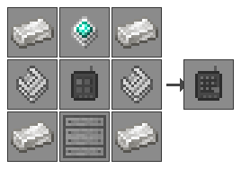
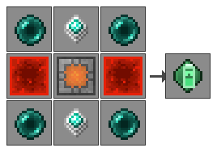
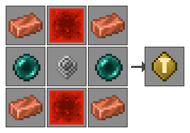
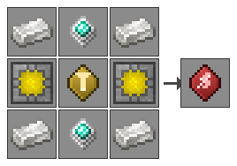
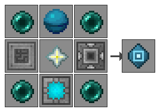
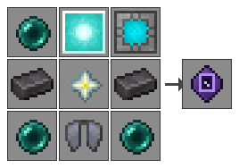
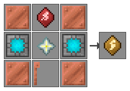

# Refined Storage - Wireless Crafting（无线合成终端）

[](https://github.com/KokuuWork/rswirelesscrafting/actions/workflows/build.yml)
[](https://github.com/KokuuWork/rswirelesscrafting/releases/latest)
[](LICENSE)


[](https://github.com/KokuuWork/rswirelesscrafting/releases)
[](https://qm.qq.com/q/ueYTU8T3xK)

**简体中文** | [English](#english)

> ## 🐞 出问题了？来 **Bug 维修 QQ 群：498700382**
> 崩溃、耗电异常、GUI 显示问题、联机/服务器故障，或者想要新功能——**直接进群说**就行（进群随便备注来意）。
> 👉 **[点击加入群聊（群号 498700382）](https://qm.qq.com/q/ueYTU8T3xK)** ｜ 也可以在 QQ 里**搜索群号 498700382** 找到我们。
> 不方便用 QQ 的话，欢迎直接提 [Issue](https://github.com/KokuuWork/rswirelesscrafting/issues)。

> 🧪 **当前版本 0.3.2**（2026-10-15）· **仍处于测试阶段**：Fabric 侧为首次移植，尚未完成完整真机验证。
> 请在测试存档中使用并**先备份世界**；遇到问题欢迎来上面的 QQ 群反馈（附日志与复现步骤）。

给 [Refined Storage 2](https://github.com/refinedmods/refinedstorage) 补上原版缺失的**无线合成**能力。

原版只有一个无线**查看**终端（`wireless_grid`）——你能远程看库存，但不能远程合成。本模组提供一个**无线合成终端**与一个**无线样板终端**（远程编写自动化样板），用六张可插拔的**装配式升级插件**把它们的续航、范围、维度与供能方式一路推到终局，再配一座**终端充电站**为所有 FE 终端补电。所有无线终端（含 RS 原生的无线终端与无线自动合成监视器）都遵循**按距离扣电**的线性价目表，离网络越远耗电越狠。


> 上图中第 1、2 个图标是同一件**无线合成终端**的两种状态：未绑定（灰）与已接入网络（亮）。

## 内容一览

| | 名称 | 作用 | 稀有度 |
|---|---|---|---|
|  | **无线合成终端**<br>`wireless_crafting_grid` | 远程访问网络并**远程合成**。潜行 + 右键打开插件装配界面。 | RARE |
|  | **无线样板终端**<br>`wireless_pattern_grid` | 远程编写**自动化样板**（合成 / 处理 / 切石 / 锻造），不用跑回样板网格。 | EPIC |
|  | **电池升级插件**<br>`battery_upgrade` | 每张提升 **+1000 FE** 电池容量（可叠加）。前期刚需。 | RARE |
|  | **初级能耗插件**<br>`energy_upgrade` | **距离能量倍率减半**。也是高级能耗插件的原料。 | RARE |
|  | **高级能耗插件**<br>`advanced_energy_upgrade` | **完全消除距离能量倍率**（跨维倍率保留）。也是远程输电插件的原料。 | EPIC |
|  | **距离升级插件**<br>`range_upgrade` | 同维度内**无视距离**。 | EPIC |
|  | **维度升级插件**<br>`interdimensional_upgrade` | 解锁**跨维度**访问。 | EPIC |
|  | **远程输电插件**<br>`remote_energy_upgrade` | **不再消耗终端自身电池**，直接花所绑定网络里的电。 | EPIC |
|  | **终端充电站**<br>`terminal_charging_station` | 3 个有线槽位快充，5 格范围内自动无线补电（**全局 3 个设备名额**）。 | — |

所有鼠标悬停说明都是活的：终端会显示**当前绑定的维度与坐标**、**已安装的插件**，以及**当前距离与收费倍率**（同维度显示格数，跨维度单独标注，与实际扣费完全一致）；每张插件会显示自己的效果、生效前提，以及从配置里实时读出的数值（电池插件显示容量加成，维度插件显示当前跨维度能量倍率，初级能耗插件显示除数）。

## 升级插件是装配式的，可随时插拔

升级插件**不写死在合成配方里**。手持任意无线终端（本模组合成终端，或 RS 原生的无线终端 / 无线自动合成监视器）**潜行 + 右键**，打开「插件装配」界面——**4 个槽位**，把插件拖进去就装、拖出来就卸，终端本体不需要重新合成，合成矩阵、能量、网络绑定全部原样保留。

- 只有真正的升级插件能放进槽位（由物品标签判定），槽位内每格最多 1 张；
- 组件层面只在真的装了插件时才写入 `upgrades` 数据组件，拔空后组件会被移除，物品 NBT 保持干净；
- 拆下来的插件原样回到背包，不会蒸发。

> 这套装配界面取代了早期的「工作台无序合成永久改造」方案——那样装上去就拿不下来了。旧方案的自定义配方与序列化器已从代码中删除。

## 无线样板终端

自动化做起来之后，最烦的一步不是合成，而是**改配方**——方块版的样板网格在基地里，矿场、下界、外岛想加一条产线就得来回跑。无线样板终端把这一步也搬到手上：**右键打开的是 RS 原汁原味的样板网格界面**（左侧资源栏、四种样板类型、JEI/REI 配方转移、样板复制全都在），但那座网格其实「装在你的终端里」。

- 界面与消耗：开界面 **5 FE × 距离倍率**；**产出一张样板 40 FE × 距离倍率**（按自动合成档计价，因为它服务的是自动化本身）。电量不足时样板不会产出（终端没电就配不了样板）。
- 「网格」本身是虚拟的：没有方块、不占区块、不用给它接线，登录进去就是它绑定的那张网络。
- 编辑状态**存在终端物品里**：配方区、样板类型、模糊模式、输出槽里没取走的样板，关掉界面再打开原样还在。
- 配方见下方「配方」一节，属终局件——它需要先有一台无线合成终端。



## 手持提示（HUD）

**默认关闭**（它属于「看一眼就好」的信息，不该常驻在屏幕上）。想要的话在配置里把「手持提示（HUD）」打开：手持**已绑定**的无线终端时，物品栏上方显示一行小字 **电量 · 距离 · 收费倍率**——出发前就知道这一趟要花多少电，不用打开背包悬停。打开任意界面时自动让位。

> 只认**手持**（主手 / 副手）。放饰品栏里不动手的时候不显示，避免屏幕上老是挂着一行字。

## 充电站

一座方块，两条充电路径，两种供电来源。**兼容 RS 的任意 FE 终端**（无线查看终端、无线合成终端、便携终端……），因为它走的是通用的 NeoForge 能量能力，而不是 RS 内部的适配器。

| | 终端充电站<br>`terminal_charging_station` |
|---|---|
| **有线**（终端放进 GUI 槽位） | **3 个槽位**，各 **200 FE/s**（**无损耗**） |
| **无线**（玩家在范围内自动补电） | **20 FE/s**（每个设备，半径 **5 格**），**45% 效率**：消耗 100 只给设备充 45，其余作传输损耗 |
| 无线并发 | **全局 3 个设备名额**，按离站距离由近到远分配：3 名玩家各充 1 个、1 名玩家独占 3 个 |
| 基础待机损耗 | **128 FE/s**（常驻，充电另算）——可用**红石信号**关掉无线充电并停扣待机损耗 |
| 内部电量缓冲 | **4000 FE**（默认，配置项 `externalCapacity` 可调） |

界面是一张 **3×2 连接面板**：上排 3 个有线槽（放物品，充电中蓝灯呼吸闪烁、充满绿灯），下排 3 个无线链接灯（正在为某名玩家充电时呼吸闪烁）。

**无线充电的开关状态直接写在方块外形上**：面板的闪电指示灯在无线开启时亮青色，被红石关掉后熄灭变灰——不用打开界面就能看出无线模块是否在工作。

| 供电来源 | 说明 |
|---|---|
| **RS 网络**（主来源） | 方块接入网络后，持续把网络电量**补进自己的内部缓冲**，补满即停 |
| **外部 FE**（兜底） | 注册标准 `Capabilities.EnergyStorage.BLOCK` 能力，其他模组用标准 FE 输电的方块/管道可以直接往缓冲里供电，纯 FE 整合包里也能用 |

界面能量条显示的是**充电站自己的缓冲电量**；待机损耗与有线 / 无线充电一律从这块缓冲里出账，缓冲没满时自动找网络补。

> 表里的速率一律是**每秒（FE/s）**。Minecraft 按 **20 tick = 1 秒** 结算，方块内部就把每秒额度摊到每 tick，除不尽的部分顺延到下一 tick，所以长期平均值精确、也不会漏电。折算成每 tick 是：有线 10、无线 1（每个设备）。
>
> 基础待机损耗同样按每秒算，否则会出现「站一空转，待机就把有线充电全吃掉」的倒挂。把它定在 128 FE/s，是故意「有惩罚感」——不关红石就一直空烧，拉了红石才省电。

## 能量模型

### 按距离扣电（所有无线终端通用）

所有无线终端——本模组的无线合成终端，以及 RS 原生的**无线终端**和**无线自动合成监视器**——每执行一次动作，消耗的能量都乘上一个**距离倍率**（配置在 `distanceEnergy` 节）：

| 水平距离（玩家 ↔ 绑定网络） | 倍率（默认） |
|---|---|
| 0 – 16 格（基础范围） | **×1** |
| 16 格以上 | 按距离**线性增长**：倍率 = 距离 ÷ 16 |
| 跨维度（需维度升级插件） | 固定 **×16** |

线性示例：32 格 ×2、64 格 ×4、256 格 ×16、400 格 ×25、1000 格 ≈ ×62。距离越远收得越狠，几百格外单次动作轻松破百 FE。

三段能耗插件就是为此准备的套娃链：

- **初级能耗插件**：距离倍率**减半**（向上取整）；
- **高级能耗插件**：距离倍率**归 1**（跨维度 ×16 仍保留）；
- **远程输电插件**：扣电直接**从绑定网络出账**，终端自身电池不再掉电，距离惩罚在实际上被网络电量抹平。

套娃不浪费：`初级能耗插件 → 高级能耗插件 → 远程输电插件`，每一级都是上一级的合成原料。

### 单次动作基础耗电

| 场景 | 电从哪来 | 单次动作耗电（默认） |
|---|---|---|
| 出厂状态 | 终端**自身电池**（容量 400 FE） | 开界面 5 · 合成 20 · 自动合成 40 · 清空矩阵 5 · 配方转移 5 |
| 装了**电池升级插件** | 同上，但容量 **+1000 FE / 张** | 同上 |
| 装了**远程输电插件** | **直接扣所绑定网络的能量**，终端自身电池不再掉电；网络无电或未绑定时自动回落成出厂行为 | 同上 |

> 无线样板终端同价目：开界面 5 · **产出一张样板 40**。它的「创建样板」按钮按下时会先查电量，付不起就当作没发生。

基础电池容量只有 **400 FE**，而距离倍率能把单次动作抬到几十甚至上百 FE——所以**电池升级插件是前期刚需**：不装它，走远一点终端很快就见底，只能反复跑回充电站。合成类动作（合成 20 / 自动合成 40）显著贵于查看（5），这正是合成终端相对普通无线终端的额外成本。

## 环境

| | 要求 |
|---|---|
| Minecraft | **1.21.1** |
| 加载器 | NeoForge **21.1.x**（1.21.1）｜ Fabric Loader **0.14.6+** |
| 前置 | Refined Storage **2.0.7+**（已在 2.0.9 上实测运行）；Fabric 侧另需 **Fabric API ≥ 0.101.0** + **Cloth Config** + **Team Reborn Energy** |
| 可选（饰品栏） | NeoForge：**Curios** + RS Curios Integration ｜ Fabric：**Trinkets** + RS Trinkets Integration |
| 构建 | JDK **21** + Gradle 8.14.4 |

## 安装

**NeoForge**：
1. 装好 NeoForge 1.21.1 与 Refined Storage。
2. 把 `rswirelesscrafting-neoforge-<version>.jar` 丢进 `mods/`。

**Fabric**：
1. 装好 Fabric 1.21.1、Fabric API 与 Refined Storage。
2. 把 `rswirelesscrafting-fabric-<version>.jar` 丢进 `mods/`，并确保已装 Cloth Config 与 Team Reborn Energy（通常随 Refined Storage 一并提供）。

两种加载器的 jar 都从 [Releases](https://github.com/KokuuWork/rswirelesscrafting/releases/latest) 下载，**二选一**（功能与配置完全一致，不要同时放进 `mods/`）。当前 0.3.2 对应 `rswirelesscrafting-neoforge-0.3.2.jar` / `rswirelesscrafting-fabric-0.3.2.jar`。

> **升级注意**：NeoForge 只会更新配置文件的**注释**、不会覆盖你已经改过的值。跨版本升级后如果发现
> `config/rswirelesscrafting-common.toml` 里「注释写的默认值」和「实际值」不一致，删掉该文件让它重新生成即可。

> 本模组是**纯附属（addon）**：只依赖 Refined Storage 的公开 API，另用一处**窄 mixin**（只包一层 `AbstractNetworkEnergyItem.use` 的上下文，让距离耗电与升级插件对 RS 原生无线终端同样生效），不 fork、不魔改 RS 本体逻辑。移除本模组不会损坏存档（已装升级插件的终端会保留数据组件，重新装上即恢复）。

## 使用

1. **建好网络**。同一维度用无线访问点（Wireless Transmitter）；跨维度需要网络变送器 + 网络接收器（Network Transmitter + Receiver）。
2. **绑定**。手持无线合成终端，对着无线访问点或网络接收器**右键**完成绑定。
3. **装插件**。**潜行 + 右键**终端打开装配界面，把升级插件拖进 4 个槽位之一。想换就拖出来。
4. **打开**。右键终端即可打开合成界面（也可在按键设置里绑定快捷键）。
5. **补电**。终端充电站摆在基地里，3 个槽位有线快充，5 格范围内的玩家自动无线补电——走过去就回电。

### 饰品栏（可选）

无线合成终端可以放进**饰品栏**，与 Refined Storage 原生无线终端**共用同一组槽位**：

| 加载器 | 额外需要安装 |
|---|---|
| NeoForge | [Curios](https://modrinth.com/mod/curios) + [RS Curios Integration](https://modrinth.com/mod/refined-storage-curios-integration) |
| Fabric | [Trinkets](https://modrinth.com/mod/trinkets) + [RS Trinkets Integration](https://modrinth.com/mod/refined-storage-trinkets-integration) |

装好后终端会出现在整合模组提供的**两个专用槽位**里，按本模组的「打开无线合成终端」快捷键即可直接开启——饰品栏里的物品不支持右键打开，这是饰品栏模组的通用约定，RS 原生终端也一样。

没装整合模组时本模组照常工作，只是没有饰品槽；**不需要它们也能玩**。

> 兼容方式是**纯数据合并**：本模组只往整合模组的槽位 tag 里追加一条 `wireless_crafting_grid`，并用 `replace: false` 保证不会顶掉 RS 原生终端的条目。这与官方为 Quartz Arsenal 的无线合成终端做兼容用的是同一套做法。

## 配方

九件内容大多定位为**后期到终局**：材料取自 Refined Storage 自带的无线设备与递归存储元件、原版最稀有的掉落。只有**电池升级插件**、**初级能耗插件**与**终端充电站**刻意压低到前中期——它们负责把曲线撑平，剩下的都是终局件。

### 无线合成终端


`Q` 石英富集铁 · `A` 高级处理器 · `P` 末影珍珠 · `G` `refinedstorage:crafting_grids` 标签（任意合成网格）· `M` 机器外壳

合计约 14 石英铁 + 2 末影珍珠 + 2 高级处理器 + 1 合成网格，约为 RS 自带「无线终端」的 **2.3 倍**——多出来的是「可合成」这份能力。

### 无线样板终端


`Q` 石英富集铁 · `A` 高级处理器 · `T` 空白样板 · `P` 无线合成终端 · `M` 机器外壳

它是**唯一一件「用终端造终端」**的配方：中心那格要放一台做好的无线合成终端，前后用**空白样板**（RS 的样板基底）夹住——语义直白：这台终端是「写样板的终端」。定价与合成终端同档，属终局。

### 电池升级插件（前期刚需）



`P` 末影珍珠 · `A` 高级处理器 · `R` 红石块 · `L` 1k存储方块

全表最便宜的一张。**1k 存储方块是 RS 存储元件递归链（1k → 4k → 16k → 64k）的入门级**，红石块是廉价的基础供能材料——两者都是早期就能量产的东西，所以这张插件在**游戏前期**就能做出来，让终端立刻从「开两次界面就没电」变成能长时间使用。

### 初级能耗插件（过渡件）



`P` 末影珍珠 · `C` 铜锭 · `R` 红石块 · `S` 基础处理器

距离耗电从基础范围外开始爬升后，这张插件把倍率**砍一半**。它是**高级能耗插件**的原料，前期做了到中期不会浪费。

### 高级能耗插件



`Q` 石英富集铁 · `P` 高级处理器 · `X` 4k存储方块 · `E` 初级能耗插件

彻底**消除距离倍率**（跨维度 ×16 仍保留）。它又是**远程输电插件**的原料——套娃链 `初级能耗插件 → 高级能耗插件 → 远程输电插件` 每一环都回收上一环，投入不打水漂。

### 距离升级插件



`P` 末影珍珠 · `H` 海洋之心 · `T` 无线访问点 · `S` 下界之星 · `R` 网络接收器 · `X` 64k存储方块

每个材料都有明确语义：**海洋之心**代表远距离能量传输，**下界之星**是撑起「无限」的能量源，**无线访问点 + 网络接收器**是 RS 通信链路的两端（本插件绑的就是访问点），**64k存储方块**则是 RS 存储元件递归链的顶点，可自动化量产但吞吐极大。

### 维度升级插件



`P` 末影珍珠 · `B` 信标 · `X` 64k存储方块 · `N` 下界合金锭 · `S` 下界之星 · `Y` 鞘翅

**鞘翅**只存在于末地船，是「跨越」的象征；**信标**需要定位与锚定（跨维隧道要求两端坐标对齐），而它本身就要消耗一颗下界之星——所以这张插件合计要 **2 颗下界之星 = 2 只凋灵**；**64k存储方块**与距离插件同级；2 个**下界合金锭**是承受维度压力的外壳。

### 远程输电插件



`C` 铜块 · `B` 高级能耗插件 · `X` 64k存储方块 · `S` 下界之星 · `L` 避雷针

与距离插件、维度插件**同级价位的终局件**，但它的配方里嵌着**高级能耗插件**——前面两级能耗插件在这里被回收利用。

四角用**铜块**（导体的代名词），中心列是**避雷针**——这是全表唯一一组「导电材料」搭配，因为这张插件讲的是电，而不是空间或维度。**下界之星**与 **64k存储方块**延续另外两张终局件的材料语言，让三张终局件看起来是一套东西。

> 早期版本四角是末影珍珠，但末影珍珠与「电」没有任何语义关系，纯粹是为了凑稀有度——现已换成铜块。

### 终端充电站


`Q` `c:gems/quartz` 标签（任意石英）· `G` 红石块 · `C` 机器外壳 · `M` 高级处理器

比三张终局卡低一个量级：8 个石英 + 4 个红石块 + 4 个机器外壳 + 1 个高级处理器。它是**功能性基建**而不是升级件，所以定价落在 RS 常规机械的区间里，前中期就能搭起来。

## 距离与维度行为

| 已装升级插件 | 同维度（绑无线访问点） | 跨维度（绑网络接收器） |
|---|---|---|
| 无 | `max(访问点范围, 64 格)` | 不可用 |
| 距离插件 | **无限** | 不可用 |
| 维度插件 | `max(访问点范围, 64 格)` | 可用（隧道，天然无限） |
| 距离插件 + 维度插件 | **无限** | 可用（隧道，天然无限） |

跨维度访问要求网络变送器与接收器**两端区块都已加载**——这是 RS 原生隧道的固有约束，本模组如实保留，没有绕过。

## 多人 / 专用服务器

设计上所有判定都放在服务端，客户端只负责显示：

- **扣电、距离倍率、跨维度、插件生效**全部在服务端算；客户端 tooltip 只是把同一套公式在玩家自己身上复算一遍用于展示。
- **快捷键打开终端**走 RS 的 `useSlotReferencedItem`（内含 c2s 包），客户端无法伪造「我有终端」。
- **插件装配界面**的槽位引用（`SlotReference`）由服务端创建，并且会把终端所在的那一格**锁死**——玩家不能在界面里把它拿走或换掉，避免改动写进已脱离背包的物品。
- **充电站**的 tick 只在服务端运行；无线充电有全局 3 个设备名额，多人同时靠近时按离站距离由近到远分配，互不抢占。
- **RS 权限管理器**照常生效：没有 `OPEN` 权限的玩家打不开终端。

已知限制（不影响正确性，只影响显示）：配置注册为 NeoForge 的 `COMMON` 类型，**专用服务器不会把 `rswirelesscrafting-common.toml` 下发给客户端**。若服主改了默认数值（如距离基础范围、跨维度倍率），玩家 tooltip 上看到的倍率会是本地配置的数值，而实际扣费以服务端为准。两边都用默认值时完全一致。

## 架构

### 终端与升级插件

核心扩展点是覆写 `AbstractNetworkEnergyItem.use(ServerPlayer, ItemStack, SlotReference)`（RS 2.0.7 的 3 参重载），注入自定义的 `ExtendedWirelessNetworkItemContext`。

为了让距离耗电与升级插件也对 **RS 原生无线终端**（无线终端、无线自动合成监视器）生效，本模组用一处**窄 mixin**（`AbstractNetworkEnergyItemMixin`）在同一个 3 参 `use` 上包一层同样的上下文，并在潜行右键时打开同一个插件装配界面。这是唯一动到 RS 类的地方，且只在父类方法上包一层、不改任何逻辑分支。

RS 的距离/维度校验并不位于 `resolveNetwork`，而在 `NetworkItemPlayerValidator`。因此本模组采用「**标准逻辑优先、升级插件兜底放宽**」策略——先让 RS 原生校验跑完，仅在原生返回空时，才根据已安装的升级插件判断是否放宽。同时刻意**不干预 `force=true` 路径**，因为 RS 依赖该语义移除失效的网格 watcher。

能量侧的扩展点是 `NetworkItemContext.isActive()` 与 `drainEnergy(long)`：距离倍率在这里按「距离线性价目 × 能耗插件」算出并叠加到每次扣电上；装了远程输电插件时「有没有电」改由绑定网络回答，扣电也直接从 `EnergyNetworkComponent.extract` 出账。

### 充电站

充电站**不**沿用 RS 的方块基类——RS 2.0.7 没有公开的方块基类（方块全部在无 `@API` 标注的内部模块里），所以方块本身继承原版 `BaseEntityBlock`，tick 走原版 `getTicker`。

注意 `BaseEntityBlock` 默认返回 `RenderShape.INVISIBLE`（原版方块实体如箱子、熔炉都是自己画模型的），所以带方块实体又想用普通 json 模型的方块必须显式覆写 `getRenderShape()` 返回 `RenderShape.MODEL`，否则方块放下后完全不画、直接看穿到后面的世界。本模组在 0.1.9 修掉了这个坑。

方块实体则继承 RS 公开且标注为 STABLE 的 `AbstractNetworkNodeContainerBlockEntity<T extends NetworkNode>`，由它负责网络容器生命周期；自定义的 `ChargingStationNetworkNode` 只声明待机耗电。网络连接用的是 RS 的默认六向连接策略，因此连 `createMainContainer` 都不用重写。

每 tick 里服务端先为 3 个有线槽各自按速率补电；**无线扫描每 10 tick 一次**（按 10 tick 的额度一次性发放，速率不变）——玩家多、充电站多时，「每 tick 遍历附近所有玩家背包」是服务器上的真实热点，降频后开销约为原来的十分之一。扫描时把全局 3 个「设备名额」按「每名玩家先拿 1 个、有余再轮」的次序分给最近的玩家——3 名玩家各充 1 个设备、1 名玩家独占 3 个，充满一个自动轮到下一个。方块状态（通电 / 无线）的写入同样限流为 10 tick 一次，避免网络只剩几 FE 时缓冲在「空 / 有一点点」之间抖动，演变成每 tick 一次的方块更新与邻居红石更新风暴。连接面板的 6 个灯（3 有线 + 3 无线）由服务端算好状态写进 `ContainerData` 同步给客户端，客户端用 `level.getGameTime()` 驱动蓝灯的呼吸闪烁——纯视觉，不占额外网络包。多名玩家各自独占一个名额，状态互不干扰。

无线充电带 **45% 效率**（`deliver` 里按 `cost = ceil(given * 100 / efficiency)` 出账，消耗 100 只充 45）；有线恒为 100%。基础待机损耗（128 FE/s）只有在无线模块开启时才会扣，被红石信号关掉后停扣。方块带一个 `wireless` 方块状态，服务端在状态变化时 `setBlockAndUpdate`，用亮/灭两套纹理让外形直接反映无线是否开启。

物品充电在两加载器上分别走各自的**通用**能量能力——NeoForge 用 `Capabilities.EnergyStorage.ITEM`、Fabric 用 Team Reborn Energy 的 `EnergyStorage.ITEM`——**不**经过 RS 的 `PlatformImpl.getEnergyStorage`（那只会认 RS 自己的适配器），这样才能兼容其他模组的 FE 物品。

完整设计文档（含决策记录、逐文件实现规格、RS 2.0.7 API 核实结果）见 [`docs/DESIGN.md`](docs/DESIGN.md)。

## 从源码构建

```bash
git clone https://github.com/KokuuWork/rswirelesscrafting.git
cd rswirelesscrafting
export JAVA_HOME="/path/to/jdk-21"
./gradlew build
```

产物位于 `rswirelesscrafting-neoforge/build/libs/`（NeoForge）与 `rswirelesscrafting-fabric/build/libs/`（Fabric）。

> 若 `maven.neoforged.net` 在你所在网络不可达，仓库内附带 `init-mirror.gradle`，可把依赖重写到 NeoForged CDN：
> ```bash
> ./gradlew -I init-mirror.gradle build
> ```

**美术资产**全部由脚本生成，只用 Python 标准库，不需要 Pillow：

| 脚本 | 产出 |
|---|---|
| `gen_textures.py` | 8 张物品纹理 + 4 张方块纹理（终端充电站 4 形态：通电/断电 × 无线开/关） |
| `gen_gui_textures.py` | 2 张 176×166 的界面背景（终端充电站、升级装配） |
| `gen_readme_images.py` | 上文的全部配图（需 `MC_CLIENT_JAR` 与 `RS_TEXTURES` 指向 1.21.1 客户端 jar 与 RS 源码树） |

## 致谢

本项目大量逻辑衍生于 [Refined Storage](https://github.com/refinedmods/refinedstorage)（MIT License, Copyright © 2020 - 2025 Refined Mods），模块结构参考了官方附属样例 [Quartz Arsenal](https://github.com/refinedmods/quartz-arsenal)。在此致谢。

## 反馈 / Bug 维修群

| 渠道 | 入口 |
|---|---|
| **QQ 群（推荐）** | 群号 **498700382** · 👉 [点击加入群聊](https://qm.qq.com/q/ueYTU8T3xK)（群名「MC-玩了X年服务器终于不想玩了」） |
| GitHub | [Issues](https://github.com/KokuuWork/rswirelesscrafting/issues) |

崩溃、耗电数值不对、GUI 显示异常、多人/服务器问题、新功能建议——**来群里直接说最快**，附上 `latest.log` 或崩溃报告就行。

## 更新日志

最新 **0.3.2**（2026-10-15，修复版）：修掉远程输电插件在网络电量不足时的**双重收费**、无线充电实际间隔 11 tick（速率被压低约 9%），并修正无线名额的过时文案。

上一版 **0.3.1**（2026-10-15）：**Fabric 移植**、**饰品栏兼容**（Curios / Trinkets）、距离耗电改**线性**（16 格内 ×1，超出按距离 ÷ 16）、跨维度 **×16**、合成 **20 FE** / 自动合成 **40 FE**、充电站改显自身缓冲并改为全局 3 设备名额、GUI 与 tooltip 修复、多人三项修复。

完整记录见 [CHANGELOG.md](CHANGELOG.md)。

## 许可

[MIT](LICENSE)

---

## English

> ## 🐞 Hit a bug? Join the **QQ support group: 498700382**
> Crashes, wrong energy numbers, GUI glitches, multiplayer/server trouble, or a feature request — come and say it
> in the group. 👉 **[Click to join (group 498700382)](https://qm.qq.com/q/ueYTU8T3xK)**, or search the group
> number **498700382** inside QQ.
> No QQ? Open an [Issue](https://github.com/KokuuWork/rswirelesscrafting/issues) instead.

> 🧪 **Current version 0.3.2** (2026-10-15) · **still a testing build**: the Fabric port is brand new and has not gone
> through full in-game verification yet. Use it in a test world and **back up your saves** first; bug reports are
> welcome in [Issues](https://github.com/KokuuWork/rswirelesscrafting/issues).

An addon for **[Refined Storage 2](https://github.com/refinedmods/refinedstorage)** that adds the wireless **crafting** grid the base mod never had.

Vanilla Refined Storage ships only a wireless *viewing* grid — you can browse your network remotely, but not craft on it. This mod adds a **Wireless Crafting Grid** and a **Wireless Pattern Terminal** (write autocrafting patterns remotely), six swappable **upgrade cards** that extend their endurance, range, dimensions and power source all the way to endgame, plus a **Terminal Charging Station** that recharges every FE-based terminal. Every wireless terminal (including RS's own wireless grid and wireless autocrafting monitor) follows a **distance-based energy tariff** — the further you are from the network, the more each action costs.


> The first two icons are the *same* item — the **Wireless Crafting Grid** — in its unbound (dim) and network-connected (lit) states.

### Contents

| | Item | Effect | Rarity |
|---|---|---|---|
|  | **Wireless Crafting Grid**<br>`wireless_crafting_grid` | Access your network remotely **and craft**. Sneak + right-click to open the upgrade panel. | rare |
|  | **Wireless Pattern Terminal**<br>`wireless_pattern_grid` | Write **autocrafting patterns** (crafting / processing / stonecutter / smithing) remotely. | epic |
|  | **Battery Upgrade**<br>`battery_upgrade` | **+1000 FE** capacity each (stacks). The early-game must-have. | rare |
|  | **Energy Upgrade**<br>`energy_upgrade` | **Halves** the distance energy multiplier. Ingredient of the Advanced Energy Upgrade. | rare |
|  | **Advanced Energy Upgrade**<br>`advanced_energy_upgrade` | **Removes** the distance multiplier (cross-dimension still applies). Ingredient of the Remote Energy Upgrade. | epic |
|  | **Range Upgrade**<br>`range_upgrade` | **Unlimited range** within the same dimension. | epic |
|  | **Interdimensional Upgrade**<br>`interdimensional_upgrade` | **Cross-dimensional** access. | epic |
|  | **Remote Energy Upgrade**<br>`remote_energy_upgrade` | Draws power **from the bound network** instead of the terminal's own battery. | epic |
|  | **Terminal Charging Station**<br>`terminal_charging_station` | 3 wired fast-charge slots, plus a 5-block wireless aura (**3 device slots total**). | — |

Tooltips are live: the terminal shows the **bound dimension and coordinates**, its **installed upgrades**, and the **current distance and energy multiplier** (distance in blocks within a dimension, a separate label when cross-dimensional — always matching what the server bills); each card explains its effect, its prerequisite, and the values read from config in real time.

### The upgrade cards are pluggable

Cards are **not** baked into a crafting recipe. **Sneak + right-click** any wireless terminal (this mod's grid, or RS's wireless grid / wireless autocrafting monitor) to open the upgrade panel — **4 slots**. Drop a card in to install it, pull it out to remove it. The terminal is never re-crafted, and its crafting matrix, stored energy and network binding are all preserved.

- Only genuine upgrade cards fit (decided by item tags); one card per slot.
- The `upgrades` data component is written only when a card is actually installed, and removed once the last one is pulled — item NBT stays clean.
- Removed cards return to your inventory intact.

> This replaced the earlier "shapeless crafting-table, permanent modification" design, where an installed card could never come back out. Those custom recipe classes have been deleted from the codebase.

### Wireless Pattern Terminal

Once your base is automated, the annoying part is not crafting — it is **editing recipes**: the block Pattern Grid lives back at base, so every new production line in a far-away outpost means a trip home. The Wireless Pattern Terminal brings that step to your hand: right-clicking it opens **RS's own Pattern Grid UI** (resource list, all four pattern types, JEI/REI recipe transfer, pattern copying — everything), but the grid itself "lives inside your terminal".

- Costs: opening the UI is **5 FE × distance multiplier**; **producing one pattern is 40 FE × distance multiplier** (priced like autocrafting, because that is what it feeds). With too little energy no pattern is produced — no power, no pattern.
- The grid is virtual: no block, no chunk loading, no cables. You log into whatever network the terminal is bound to.
- The editing state is **stored on the item**: matrix, pattern type, fuzzy mode and any pattern still sitting in the output slot all survive closing and reopening the UI.
- It is an endgame craft (see Recipes) — you need a Wireless Crafting Grid first.


### Held-item HUD

**Off by default** (it is a "nice to glance at" line and should not live on your screen). Turn on "Held-item HUD" in the config and holding a bound wireless terminal shows a single small line above the hotbar: **energy · distance · cost multiplier** — so you know what a trip will cost before you set out, without opening your inventory. It steps aside whenever a screen is open.

> Held items only (main hand / offhand). Terminals worn in a trinket slot do not show it, so no line is permanently stuck on screen.

### Charging Station

One block, two charging paths, two power sources. It works with **any FE terminal from Refined Storage** (wireless grid, wireless crafting grid, portable grid, …) because it uses each loader's generic energy capability (NeoForge `Capabilities.EnergyStorage.ITEM`, Fabric Team Reborn Energy) rather than RS's internal adapter.

| | Terminal Charging Station<br>`terminal_charging_station` |
|---|---|
| **Wired** (terminal in the GUI slot) | **3 slots** at **200 FE/s** each (**lossless**) |
| **Wireless** (players in range) | **20 FE/s** per device (radius **5 blocks**), at **45% efficiency**: drawing 100 only puts 45 into the device, the rest is lost |
| Wireless concurrency | **3 device slots total**, assigned nearest-first: 3 players get 1 each, 1 player gets all 3 |
| Base idle drain | **128 FE/s** (constant; charging billed separately) — a **redstone signal** shuts off wireless charging and pauses the idle drain |
| Internal energy buffer | **4000 FE** (default; configurable via `externalCapacity`) |

The GUI is a **3×2 connection panel**: three wired slots up top (blue breathing light while charging, green when full) and three wireless link lights below (breathing while charging a player).

**The wireless on/off state is visible on the block itself**: the panel's lightning bolt glows cyan while wireless is on and dims to grey when a redstone signal turns it off — no need to open the GUI to see whether the wireless module is running.

| Power source | Notes |
|---|---|
| **RS network** (primary) | The block tops its **internal buffer** up from the network and stops once full |
| **External FE** (fallback) | Registers the standard `Capabilities.EnergyStorage.BLOCK` capability, so other mods' FE generators and cables can feed the buffer directly — it works in pure-FE packs too |

The GUI's energy bar shows the station's **own buffer**. Idle drain and both charging paths are billed against that buffer, which refills from the network whenever it is not full.

> Every rate above is **per second (FE/s)**. Minecraft settles on **20 ticks = 1 second**, so the block spreads the per-second budget across the ticks of each second and carries the remainder over, which keeps the long-run average exact and never leaks energy. Per tick that works out to: wired 10, wireless 1 (per device).
>
> The base idle drain is per second too — otherwise a station would burn energy doing nothing, more than it can deliver when charging. It is deliberately high (128 FE/s) so that leaving the redstone switch off actually costs you: the switch is the way to save.

### Energy model

#### Distance tariff (all wireless terminals)

Every wireless terminal — this mod's grid and RS's own **wireless grid** and **wireless autocrafting monitor** — multiplies each action's energy cost by a **distance multiplier** (configured under `distanceEnergy`):

| Horizontal distance (player ↔ bound network) | Multiplier (default) |
|---|---|
| 0 – 16 blocks (base range) | **×1** |
| beyond 16 blocks | grows **linearly**: multiplier = distance ÷ 16 |
| cross-dimensional (needs the Interdimensional Upgrade) | fixed **×16** |

Linear examples: 32 blocks ×2, 64 blocks ×4, 256 blocks ×16, 400 blocks ×25, 1000 blocks ≈ ×62. The further you are, the steeper the cost.

Three energy upgrades form a non-wasteful nesting chain for this:

- **Energy Upgrade**: halves the distance multiplier (rounding up);
- **Advanced Energy Upgrade**: removes the distance multiplier (cross-dimension ×16 still applies);
- **Remote Energy Upgrade**: pays the bill straight out of the bound network, so the terminal's battery never drains — the distance penalty is effectively absorbed by network power.

`Energy Upgrade → Advanced Energy Upgrade → Remote Energy Upgrade`: each one is the crafting ingredient of the next.

#### Cost per action

| Situation | Where the power comes from | Cost per action (default) |
|---|---|---|
| Stock | The terminal's **own battery** (400 FE) | open 5 · craft 20 · autocraft 40 · clear matrix 5 · recipe transfer 5 |
| **Battery Upgrade** installed | Same, but capacity **+1000 FE per card** | unchanged |
| **Remote Energy Upgrade** installed | **Straight out of the bound network**; the terminal's battery is untouched. Falls back to stock behaviour if the network is empty or unbound. | unchanged |

The Wireless Pattern Terminal shares the same tariff: open 5, **produce one pattern 40**. Its "create pattern" button checks your energy first — if you cannot pay, nothing happens.

The base battery is only **400 FE**, while the distance multiplier can push a single action into the tens or hundreds of FE — so the **Battery Upgrade is an early-game necessity**: without it the terminal runs dry fast once you wander away, forcing you to trudge back to a charging station. Crafting actions (craft 20 / autocraft 40) cost far more than viewing (5), which is the extra price of a crafting terminal over a plain viewing terminal.

### Requirements

- Minecraft **1.21.1**; **NeoForge 21.1.x** or **Fabric Loader 0.14.6+**; Refined Storage **2.0.7+** (verified on 2.0.9). On Fabric you also need Fabric API **≥ 0.101.0**, Cloth Config and Team Reborn Energy (normally bundled with Refined Storage).
- Optional, for a trinket slot: Curios + RS Curios Integration (NeoForge) or Trinkets + RS Trinkets Integration (Fabric).
- Pure addon — no forking; one narrow mixin (wrapping `AbstractNetworkEnergyItem.use` so distance energy and upgrade cards also apply to RS's own wireless terminals), no permanent changes to your world (terminals keep their data components if you uninstall; they come back when you reinstall).
- Download from [Releases](https://github.com/KokuuWork/rswirelesscrafting/releases/latest) — pick **one** jar for your loader, never both. When upgrading, delete `config/rswirelesscrafting-common.toml` if its commented defaults no longer match the actual values.

### Trinket / Curio slots (optional)

The wireless crafting grid fits into a **trinket slot**, sharing the same two slots as Refined Storage's own wireless terminals:

| Loader | Install additionally |
|---|---|
| NeoForge | [Curios](https://modrinth.com/mod/curios) + [RS Curios Integration](https://modrinth.com/mod/refined-storage-curios-integration) |
| Fabric | [Trinkets](https://modrinth.com/mod/trinkets) + [RS Trinkets Integration](https://modrinth.com/mod/refined-storage-trinkets-integration) |

Once installed the terminal appears in the two dedicated slots and opens with this mod's "open wireless crafting grid" keybinding — items in trinket slots are not right-clickable, which is the usual trinket-mod convention and applies to stock RS terminals as well. Without the integration mod everything still works, you simply have no trinket slot.

> This is a **pure data merge**: the mod appends a single `wireless_crafting_grid` entry to the integration's slot tag with `replace: false`, so Refined Storage's own terminals keep their entries. It's the same approach the official integrations use for Quartz Arsenal's wireless crafting grid.

### Recipes

Most of the six items are late-game crafts, built around Refined Storage's own wireless hardware and nested storage parts plus the rarest vanilla drops. Only the **Battery Upgrade** and the **Terminal Charging Station** sit in the early-to-mid game, to keep the progression curve gentle.

  

The **Battery Upgrade** is the cheap one — 1k storage blocks and redstone blocks are early-game materials, so the grid stops running dry long before the endgame cards are affordable. It is also the ingredient of the **Remote Energy Upgrade**, so the early investment is never wasted. The **Terminal Charging Station** is priced like RS's ordinary machines: it is infrastructure, not an upgrade.


The three endgame cards share one material language (nether star + 64k storage block), so they read as a set. The **Remote Energy Upgrade** is the one that talks about electricity rather than space, so its corners are **copper blocks** — the conductor — with a lightning rod down the middle; earlier builds used ender pearls there, which had no relation to power at all.


The **Terminal Charging Station** is priced like RS's ordinary machines — quartz, redstone blocks, a machine casing and an advanced processor. It is infrastructure, not an upgrade.

### Range and dimensions

| Installed | Same dimension (bound to a Wireless Transmitter) | Cross-dimensional (bound to a Network Receiver) |
|---|---|---|
| — | `max(transmitter range, 64 blocks)` | unavailable |
| Range Upgrade | **unlimited** | unavailable |
| Interdimensional Upgrade | `max(transmitter range, 64 blocks)` | available (tunnel, inherently unlimited) |
| Both | **unlimited** | available |

Cross-dimensional access requires both the Transmitter and Receiver chunks to be loaded — an inherent constraint of RS's native link, faithfully preserved rather than worked around.

### Multiplayer / dedicated servers

Everything that decides anything runs server-side; the client only renders:

- **Energy drain, distance tariff, cross-dimension handling and card effects** are all computed on the server. The client tooltip merely re-runs the same formula for the local player to display it.
- **The hotkey** goes through RS's `useSlotReferencedItem` (which contains a c2s packet), so a client cannot fake "I have a terminal".
- **The upgrade panel's** `SlotReference` is created server-side, and the slot holding the terminal is **locked** — the player cannot pick it up or swap it out while the panel is open, so edits can never land on a stack that already left the inventory.
- **The Charging Station** only ticks on the server. Its three wireless device slots are a global quota: when several players stand nearby they are assigned nearest-first and never steal each other's slot.
- **RS's Security Manager** still applies — players without the `OPEN` permission cannot open the terminal.

Known limitation (display only, not correctness): the config is registered as a NeoForge `COMMON` config, and **dedicated servers do not push `rswirelesscrafting-common.toml` to clients**. If an admin changes the defaults (base range, cross-dimension multiplier, …), players will see their own local values in the tooltip while the server bills by its own config. With default values on both sides everything matches.

### How it works

**Grid and cards.** The core extension point is overriding `AbstractNetworkEnergyItem.use(ServerPlayer, ItemStack, SlotReference)` to inject a custom `ExtendedWirelessNetworkItemContext`. To make distance energy and upgrade cards work on RS's own wireless terminals (wireless grid, wireless autocrafting monitor) too, a single narrow mixin (`AbstractNetworkEnergyItemMixin`) wraps the very same 3-arg `use` and opens the same upgrade panel on sneak-right-click — this is the only place that touches RS classes, and it only wraps a parent method without changing any logic branch. RS's distance/dimension check lives in `NetworkItemPlayerValidator`, not in `resolveNetwork`, so upgrades apply as a **fallback relaxation** — the standard resolution runs first, and only when it comes back empty do the installed cards get a say. The `force=true` path is deliberately left untouched, since RS relies on that semantic to remove stale grid watchers. On the energy side, `isActive()` and `drainEnergy(long)` are overridden so the distance tariff is computed and applied to every drain, and the bound network answers "is there power?" and pays the bill when the Remote Energy Upgrade is installed.

**Charging Station.** RS 2.0.7 exposes no public block base class (blocks live in an internal, un-annotated module), so the block extends vanilla `BaseEntityBlock` and uses vanilla `getTicker`. Note that `BaseEntityBlock` returns `RenderShape.INVISIBLE` by default — vanilla's own block entities such as chests and furnaces draw themselves — so a block entity block that wants an ordinary json model has to override `getRenderShape()` and return `RenderShape.MODEL`, or it renders as nothing at all and you see straight through it. Fixed in 0.1.9. The block entity extends the STABLE-annotated `AbstractNetworkNodeContainerBlockEntity<T extends NetworkNode>`, with a minimal `ChargingStationNetworkNode` declaring the idle draw; RS's default six-way connection strategy means `createMainContainer` needs no override at all. Each tick it tops up the three wired slots, and every 10 ticks it scans nearby players (nearest first) and hands out three device slots round-robin — three players charge one device each, a single player charges all three. The scan is deliberately throttled: on a busy server, walking every nearby player's inventory every tick for every station is a real hot spot, and charging the 10-tick budget in one go gives the same rate for a tenth of the cost. The block's powered/wireless states are also rate-limited to one write per 10 ticks, so a nearly-empty network (where the buffer flickers between "empty" and "a few FE") can't turn into a block-update and redstone-neighbour storm. The six panel lights (3 wired + 3 wireless) are computed server-side and synced through `ContainerData`; the client drives the blue breathing pulse off `level.getGameTime()`, so it's purely visual with no extra packets. Item charging uses each loader's generic energy capability (NeoForge `Capabilities.EnergyStorage.ITEM`, Fabric Team Reborn Energy) rather than RS's `PlatformImpl.getEnergyStorage` (which only recognises RS's own adapter), which is what makes it compatible with other mods' FE items.

**GUI backgrounds.** The custom screens use 176×166 backgrounds, so they must draw with the explicit-texture-size `blit` overload — the 7-arg `blit(loc, x, y, u, v, w, h)` silently assumes a 256×256 texture, which magnifies only the top-left corner of the background and made the slots look misaligned with an "invisible" inventory. Fixed in 0.1.10.

See [`docs/DESIGN.md`](docs/DESIGN.md) for the full design document.

### Building

```bash
git clone https://github.com/KokuuWork/rswirelesscrafting.git
cd rswirelesscrafting
export JAVA_HOME="/path/to/jdk-21"
./gradlew build
```

The jars land in `rswirelesscrafting-neoforge/build/libs/` (NeoForge) and `rswirelesscrafting-fabric/build/libs/` (Fabric).

All artwork is script-generated with the Python standard library (no Pillow): `gen_textures.py` (item and block textures), `gen_gui_textures.py` (176×166 GUI backgrounds) and `gen_readme_images.py` (the images above; needs `MC_CLIENT_JAR` and `RS_TEXTURES`).

### Feedback / support group

| Channel | Where |
|---|---|
| **QQ group (fastest)** | Group **498700382** · 👉 [Click to join](https://qm.qq.com/q/ueYTU8T3xK) |
| GitHub | [Issues](https://github.com/KokuuWork/rswirelesscrafting/issues) |

Bring a `latest.log` or crash report and the group is the quickest way to get a fix.

### Credits

Large parts of this project derive from [Refined Storage](https://github.com/refinedmods/refinedstorage) (MIT License, Copyright © 2020 - 2025 Refined Mods). The module layout follows the official addon example [Quartz Arsenal](https://github.com/refinedmods/quartz-arsenal).

Licensed under [MIT](LICENSE).
