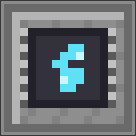
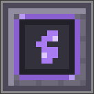
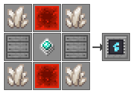
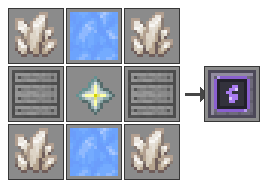

# Refined Storage - Wireless Crafting

[](https://github.com/KokuuWork/rswirelesscrafting/actions/workflows/build.yml)
[](https://github.com/KokuuWork/rswirelesscrafting/releases/latest)
[](LICENSE)


**简体中文** | [English](#english)

给 [Refined Storage 2](https://github.com/refinedmods/refinedstorage) 补上原版缺失的**无线合成**能力。

原版只有一个无线**查看**终端（`wireless_grid`）——你能远程看库存，但不能远程合成。本模组提供一个**无线合成终端**，用四张可插拔的**装配式升级卡**把它的续航、范围、维度与供能方式一路推到终局，再配**400V 风冷 / 800V 液冷两档充电站**为所有 FE 终端补电。


> 上图中第 1、2 个图标是同一件**无线合成终端**的两种状态：未绑定（灰）与已接入网络（亮）。

## 内容一览

| | 名称 | 作用 | 稀有度 |
|---|---|---|---|
|  | **无线合成终端**<br>`wireless_crafting_grid` | 远程访问网络并**远程合成**。潜行 + 右键打开升级装配界面。 | RARE |
|  | **电池升级卡**<br>`battery_upgrade` | 每张提升 **+1000 FE** 电池容量（可叠加）。也是输电卡的合成原料。 | RARE |
|  | **范围升级卡**<br>`range_upgrade` | 同维度内**无视距离**。 | EPIC |
|  | **维度升级卡**<br>`interdimensional_upgrade` | 解锁**跨维度**访问。 | EPIC |
|  | **远距离输电升级卡**<br>`remote_energy_upgrade` | **不再消耗终端自身电池**，直接花所绑定网络里的电。 | EPIC |
|  | **400V 风冷充电站**<br>`air_cooled_charging_station` | 入门基建：槽位有线快充，4 格范围内的玩家自动无线补电。 | — |
|  | **800V 液冷充电站**<br>`liquid_cooled_charging_station` | 终局基建：有线与无线速率都翻倍以上，无线覆盖 10 格。 | — |

所有鼠标悬停说明都是活的：终端会显示**当前绑定的维度与坐标**和**已安装的升级卡**；每张卡会显示自己的效果、生效前提，以及从配置里实时读出的数值（电池卡显示容量加成，维度卡显示当前跨维度能量倍率）。

## 升级卡是装配式的，可随时插拔

升级卡**不写死在合成配方里**。手持无线合成终端**潜行 + 右键**，打开「升级装配」界面——**4 个槽位**，把卡拖进去就装、拖出来就卸，终端本体不需要重新合成，合成矩阵、能量、网络绑定全部原样保留。

- 只有真正的升级卡能放进槽位（由物品标签判定），槽位内每格最多 1 张；
- 组件层面只在真的装了卡时才写入 `upgrades` 数据组件，拔空后组件会被移除，物品 NBT 保持干净；
- 拆下来的卡原样回到背包，不会蒸发。

> 这套装配界面取代了早期的「工作台无序合成永久改造」方案——那样装上去就拿不下来了。旧方案的自定义配方与序列化器已从代码中删除。

## 充电站

两座方块，两条充电路径，两种供电来源。**兼容 RS 的任意 FE 终端**（无线查看终端、无线合成终端、便携终端……），因为它走的是通用的 NeoForge 能量能力，而不是 RS 内部的适配器。

| | 400V 风冷<br>`air_cooled_charging_station` | 800V 液冷<br>`liquid_cooled_charging_station` |
|---|---|---|
| **有线**（终端放进 GUI 槽位） | **120 FE/s** | **240 FE/s** |
| **无线**（玩家在范围内自动补电） | **20 FE/s**，半径 **4 格** | **80 FE/s**，半径 **10 格** |
| 待机耗电 | 8 FE/s | 32 FE/s |
| 外部 FE 缓冲 | 10000 FE | 40000 FE |

两座站共用同一套方块实体与界面，只在数值与外观上分档：界面背景和能量条主色随规格切换（风冷青蓝、液冷紫），方块物品的 tooltip 会直接列出**这一档当前生效的数值**（改配置也会跟着变，不会出现文案与实物不符）。

| 供电来源 | 说明 |
|---|---|
| **RS 网络**（主来源） | 与 RS 其他机械一致：方块接入网络后，待机耗电直接从 `EnergyNetworkComponent` 抽取 |
| **外部 FE 缓冲**（兜底） | 注册标准 `Capabilities.EnergyStorage.BLOCK` 能力，其他模组用标准 FE 输电的方块/管道可以给它供电，纯 FE 整合包里也能用 |

取电优先级是**网络优先、缓冲兜底**；网络抽不出来（未联网或网络空）时才动内部缓冲。GUI 里两条能量条分别显示网络存量与外部缓冲。

> 表里的速率一律是**每秒（FE/s）**。Minecraft 按 **20 tick = 1 秒** 结算，方块内部就把每秒额度摊到每 tick，除不尽的部分顺延到下一 tick，所以长期平均值精确、也不会漏电。折算成每 tick 是：400V 有线 6、无线 1；800V 有线 12、无线 4。
>
> 待机耗电同样按每秒算，否则会出现「站一空转，待机就把有线充电全吃掉」的倒挂（8 FE/t = 160 FE/s，比 120 FE/s 的充电输出还高）。

## 能量模型

| 场景 | 电从哪来 | 单次动作耗电（默认） |
|---|---|---|
| 出厂状态 | 终端**自身电池**（容量 1000 FE） | 开界面 5 · 合成 5 · 自动合成 10 · 清空矩阵 5 · 配方转移 5 |
| 装了**电池升级卡** | 同上，但容量 **+1000 FE / 张**（4 槽叠满 = 5000 FE） | 同上 |
| 装了**远距离输电升级卡** | **直接扣所绑定网络的能量**，终端自身电池不再掉电；网络无电或未绑定时自动回落成出厂行为 | 同上 |

**跨维度时所有耗电 ×1.5**（配置项 `interdimensionalEnergyMultiplier`，默认 `150`），在输电卡与自身电池两条路径上都生效。

## 环境

| | 要求 |
|---|---|
| Minecraft | **1.21.1** |
| 模组加载器 | NeoForge **21.1.x** |
| 前置 | Refined Storage **2.0.7+**（已在 2.0.9 上实测运行） |
| 构建 | JDK **21** + Gradle 8.14.4 |

## 安装

1. 装好 NeoForge 1.21.1 与 Refined Storage。
2. 把 `rswirelesscrafting-neoforge-<version>.jar`（从 [Releases](https://github.com/KokuuWork/rswirelesscrafting/releases/latest) 下载）丢进 `mods/`。
3. 启动游戏。

> 本模组是**纯附属（addon）**：不 fork、不 mixin Refined Storage 本体，只依赖其公开 API。移除本模组不会损坏存档（已装升级卡的终端会保留数据组件，重新装上即恢复）。

## 使用

1. **建好网络**。同一维度用无线访问点（Wireless Transmitter）；跨维度需要网络变送器 + 网络接收器（Network Transmitter + Receiver）。
2. **绑定**。手持无线合成终端，对着无线访问点或网络接收器**右键**完成绑定。
3. **装卡**。**潜行 + 右键**终端打开装配界面，把升级卡拖进 4 个槽位之一。想换卡就拖出来。
4. **打开**。右键终端即可打开合成界面（也可在按键设置里绑定快捷键）。
5. **补电**。通风冷站适合摆在工作台旁随身补；液冷站半径 10 格，一座就能罩住整间基地，走过去自动回电。

## 配方

七件内容大多定位为**后期到终局**：材料取自 Refined Storage 自带的无线设备与递归存储元件、原版最稀有的掉落。只有**电池升级卡**与 **400V 风冷充电站**刻意压低到前中期——它们负责把曲线撑平，剩下的都是终局件。

### 无线合成终端


`Q` 石英富集铁 · `A` 高级处理器 · `P` 末影珍珠 · `G` `refinedstorage:crafting_grids` 标签（任意合成网格）· `M` 机器外壳

合计约 14 石英铁 + 2 末影珍珠 + 2 高级处理器 + 1 合成网格，约为 RS 自带「无线终端」的 **2.3 倍**——多出来的是「可合成」这份能力。

### 电池升级卡（过渡件）


`P` 末影珍珠 · `A` 高级处理器 · `R` 红石块 · `L` 1k存储方块

全表最便宜的一张。**1k 存储方块是 RS 存储元件递归链（1k → 4k → 16k → 64k）的入门级**，红石块是廉价的基础供能材料——两者都是早期就能量产的东西，所以这张卡在**游戏前期**就能做出来，让终端立刻从「开两次界面就没电」变成能长时间使用。

它同时是**远距离输电卡的合成原料**：先把这张卡做出来用着，等中期材料齐了，它不会被浪费——直接升级成输电卡。这条路线刻意避免了「前期为了过渡造的东西到后期变成垃圾」。

### 范围升级卡


`P` 末影珍珠 · `H` 海洋之心 · `T` 无线访问点 · `S` 下界之星 · `R` 网络接收器 · `X` 64k存储方块

每个材料都有明确语义：**海洋之心**代表远距离能量传输，**下界之星**是撑起「无限」的能量源，**无线访问点 + 网络接收器**是 RS 通信链路的两端（本卡绑的就是访问点），**64k存储方块**则是 RS 存储元件递归链的顶点，可自动化量产但吞吐极大。

### 维度升级卡


`P` 末影珍珠 · `B` 信标 · `X` 64k存储方块 · `N` 下界合金锭 · `S` 下界之星 · `Y` 鞘翅

**鞘翅**只存在于末地船，是「跨越」的象征；**信标**需要定位与锚定（跨维隧道要求两端坐标对齐），而它本身就要消耗一颗下界之星——所以这张卡合计要 **2 颗下界之星 = 2 只凋灵**；**64k存储方块**与范围卡同级；2 个**下界合金锭**是承受维度压力的外壳。

### 远距离输电升级卡


`C` 铜块 · `B` 电池升级卡 · `X` 64k存储方块 · `S` 下界之星 · `L` 避雷针

与范围卡、维度卡**同级价位的终局件**，但它的配方里嵌着**电池升级卡**——前期做的过渡件在这里被回收利用。

四角用**铜块**（导体的代名词），中心列是**避雷针**——这是全表唯一一组「导电材料」搭配，因为这张卡讲的是电，而不是空间或维度。**下界之星**与 **64k存储方块**延续另外两张卡的材料语言，让三张终局卡看起来是一套东西。

> 早期版本四角是末影珍珠，但末影珍珠与「电」没有任何语义关系，纯粹是为了凑稀有度——现已换成铜块。

### 400V 风冷充电站



`Q` `c:gems/quartz` 标签（任意石英）· `G` 红石块 · `C` 机器外壳 · `M` 高级处理器

比三张终局卡低一个量级：8 个石英 + 4 个红石块 + 4 个机器外壳 + 1 个高级处理器。它是**功能性基建**而不是升级件，所以定价落在 RS 常规机械的区间里，前中期就能搭起来。

### 800V 液冷充电站



`Q` `c:gems/quartz` 标签（任意石英）· `G` 蓝冰 · `C` 机器外壳 · `M` 下界之星

与风冷站同一张图案、同一套材料语言，只把两处升级：红石块换成**蓝冰**（液冷介质），中心的高级处理器换成**下界之星**。速率与覆盖都翻倍以上的代价，就是一颗下界之星。

两座站摆在一起能一眼看出是同一个「机柜」的两种配置——这也正是实际效果：同一套方块实体、同一个界面，只是档位不同。

## 距离与维度行为

| 已装升级卡 | 同维度（绑无线访问点） | 跨维度（绑网络接收器） |
|---|---|---|
| 无 | `max(访问点范围, 64 格)` | 不可用 |
| 范围卡 | **无限** | 不可用 |
| 维度卡 | `max(访问点范围, 64 格)` | 可用（隧道，天然无限） |
| 范围卡 + 维度卡 | **无限** | 可用（隧道，天然无限） |

跨维度访问要求网络变送器与接收器**两端区块都已加载**——这是 RS 原生隧道的固有约束，本模组如实保留，没有绕过。

## 架构

### 终端与升级卡

唯一的扩展点是覆写 `AbstractNetworkEnergyItem.use(ServerPlayer, ItemStack, SlotReference)`（RS 2.0.7 的 3 参重载），注入自定义的 `ExtendedWirelessNetworkItemContext`。

RS 的距离/维度校验并不位于 `resolveNetwork`，而在 `NetworkItemPlayerValidator`。因此本模组采用「**标准逻辑优先、升级卡兜底放宽**」策略——先让 RS 原生校验跑完，仅在原生返回空时，才根据已安装的升级卡判断是否放宽。同时刻意**不干预 `force=true` 路径**，因为 RS 依赖该语义移除失效的网格 watcher。

能量侧的扩展点是 `NetworkItemContext.isActive()` 与 `drainEnergy(long)`：装了输电卡时「有没有电」改由绑定网络回答，扣电也直接从 `EnergyNetworkComponent.extract` 出账。

### 充电站

充电站**不**沿用 RS 的方块基类——RS 2.0.7 没有公开的方块基类（方块全部在无 `@API` 标注的内部模块里），所以方块本身继承原版 `BaseEntityBlock`，tick 走原版 `getTicker`。

注意 `BaseEntityBlock` 默认返回 `RenderShape.INVISIBLE`（原版方块实体如箱子、熔炉都是自己画模型的），所以带方块实体又想用普通 json 模型的方块必须显式覆写 `getRenderShape()` 返回 `RenderShape.MODEL`，否则方块放下后完全不画、直接看穿到后面的世界。本模组在 0.1.9 修掉了这个坑。

方块实体则继承 RS 公开且标注为 STABLE 的 `AbstractNetworkNodeContainerBlockEntity<T extends NetworkNode>`，由它负责网络容器生命周期；自定义的 `ChargingStationNetworkNode` 只声明待机耗电。网络连接用的是 RS 的默认六向连接策略，因此连 `createMainContainer` 都不用重写。

400V 与 800V 是**同一个方块类、同一个方块实体类型**的两份实例：`ChargingStationBlock` 带一个档位字段，方块实体在构造时从 `BlockState` 反查档位，据此决定读哪一节配置（`airCooledChargingStation` / `liquidCooledChargingStation`）。界面按档位切换背景与能量条主色，其余逻辑完全共用——两档之间没有一行重复代码。

物品充电走 NeoForge 的 `Capabilities.EnergyStorage.ITEM`，**不**经过 RS 的 `PlatformImpl.getEnergyStorage`（那只会认 RS 自己的适配器），这样才能兼容其他模组的 FE 物品。

完整设计文档（含决策记录、逐文件实现规格、RS 2.0.7 API 核实结果）见 [`docs/DESIGN.md`](docs/DESIGN.md)。

## 从源码构建

```bash
git clone https://github.com/KokuuWork/rswirelesscrafting.git
cd rswirelesscrafting
export JAVA_HOME="/path/to/jdk-21"
./gradlew build
```

产物位于 `rswirelesscrafting-neoforge/build/libs/`。

> 若 `maven.neoforged.net` 在你所在网络不可达，仓库内附带 `init-mirror.gradle`，可把依赖重写到 NeoForged CDN：
> ```bash
> ./gradlew -I init-mirror.gradle build
> ```

**美术资产**全部由脚本生成，只用 Python 标准库，不需要 Pillow：

| 脚本 | 产出 |
|---|---|
| `gen_textures.py` | 6 张物品纹理 + 2 张方块纹理（风冷 / 液冷充电站） |
| `gen_gui_textures.py` | 3 张 176×166 的界面背景（风冷 / 液冷充电站、升级装配） |
| `gen_readme_images.py` | 上文的全部配图（需 `MC_CLIENT_JAR` 与 `RS_TEXTURES` 指向 1.21.1 客户端 jar 与 RS 源码树） |

## 致谢

本项目大量逻辑衍生于 [Refined Storage](https://github.com/refinedmods/refinedstorage)（MIT License, Copyright © 2020 - 2025 Refined Mods），模块结构参考了官方附属样例 [Quartz Arsenal](https://github.com/refinedmods/quartz-arsenal)。在此致谢。

## 许可

[MIT](LICENSE)

---

## English

An addon for **[Refined Storage 2](https://github.com/refinedmods/refinedstorage)** that adds the wireless **crafting** grid the base mod never had.

Vanilla Refined Storage ships only a wireless *viewing* grid — you can browse your network remotely, but not craft on it. This mod adds a **Wireless Crafting Grid**, four swappable **upgrade cards** that extend its endurance, range, dimensions and power source all the way to endgame, plus two **Charging Stations** (400V air-cooled / 800V liquid-cooled) that recharge every FE-based terminal.


> The first two icons are the *same* item — the **Wireless Crafting Grid** — in its unbound (dim) and network-connected (lit) states.

### Contents

| | Item | Effect | Rarity |
|---|---|---|---|
|  | **Wireless Crafting Grid**<br>`wireless_crafting_grid` | Access your network remotely **and craft**. Sneak + right-click to open the upgrade panel. | rare |
|  | **Battery Upgrade**<br>`battery_upgrade` | **+1000 FE** capacity each (stacks). Also the ingredient of the Remote Energy Upgrade. | rare |
|  | **Range Upgrade**<br>`range_upgrade` | **Unlimited range** within the same dimension. | epic |
|  | **Interdimensional Upgrade**<br>`interdimensional_upgrade` | **Cross-dimensional** access. | epic |
|  | **Remote Energy Upgrade**<br>`remote_energy_upgrade` | Draws power **from the bound network** instead of the grid's own battery. | epic |
|  | **400V Air-Cooled Charging Station**<br>`air_cooled_charging_station` | Early infrastructure: fast wired slot, plus a 4-block wireless aura. | — |
|  | **800V Liquid-Cooled Charging Station**<br>`liquid_cooled_charging_station` | Endgame infrastructure: more than double the rates, 10-block coverage. | — |

Tooltips are live: the grid shows the **bound dimension and coordinates** and its **installed upgrades**; each card explains its effect, its prerequisite, and the values read from config in real time.

### The upgrade cards are pluggable

Cards are **not** baked into a crafting recipe. **Sneak + right-click** the grid to open the upgrade panel — **4 slots**. Drop a card in to install it, pull it out to remove it. The grid is never re-crafted, and its crafting matrix, stored energy and network binding are all preserved.

- Only genuine upgrade cards fit (decided by item tags); one card per slot.
- The `upgrades` data component is written only when a card is actually installed, and removed once the last one is pulled — item NBT stays clean.
- Removed cards return to your inventory intact.

> This replaced the earlier "shapeless crafting-table, permanent modification" design, where an installed card could never come back out. Those custom recipe classes have been deleted from the codebase.

### Charging Station

Two blocks, two charging paths, two power sources. They work with **any FE terminal from Refined Storage** (wireless grid, wireless crafting grid, portable grid, …) because they use the generic NeoForge energy capability rather than RS's internal adapter.

| | 400V Air-Cooled<br>`air_cooled_charging_station` | 800V Liquid-Cooled<br>`liquid_cooled_charging_station` |
|---|---|---|
| **Wired** (terminal in the GUI slot) | **120 FE/s** | **240 FE/s** |
| **Wireless** (players in range) | **20 FE/s**, radius **4 blocks** | **80 FE/s**, radius **10 blocks** |
| Idle draw | 8 FE/s | 32 FE/s |
| External FE buffer | 10000 FE | 40000 FE |

Both share one block entity and one screen, differing only in numbers and looks: the GUI background and energy-bar colour follow the tier (cyan for air-cooled, violet for liquid-cooled), and the item tooltip lists **the values actually in effect** for that tier, so it tracks your config instead of going stale.

| Power source | Notes |
|---|---|
| **RS network** (primary) | Like every other RS machine: the idle draw comes straight out of the network's `EnergyNetworkComponent` |
| **External FE buffer** (fallback) | Registers the standard `Capabilities.EnergyStorage.BLOCK` capability, so other mods' FE generators and cables can feed it — it works in pure-FE packs too |

Power is drawn **network first, buffer second**. The GUI shows both bars.

> Every rate above is **per second (FE/s)**. Minecraft settles on **20 ticks = 1 second**, so the block spreads the per-second budget across the ticks of each second and carries the remainder over, which keeps the long-run average exact and never leaks energy. Per tick that works out to: 400V wired 6, wireless 1; 800V wired 12, wireless 4.
>
> The idle draw is per second too — otherwise a station would burn 8 FE/t = 160 FE/s doing nothing, more than the 120 FE/s it can deliver when charging.

### Energy model

| Situation | Where the power comes from | Cost per action (default) |
|---|---|---|
| Stock | The grid's **own battery** (1000 FE) | open 5 · craft 5 · autocraft 10 · clear matrix 5 · recipe transfer 5 |
| **Battery Upgrade** installed | Same, but capacity **+1000 FE per card** (4 slots = 5000 FE) | unchanged |
| **Remote Energy Upgrade** installed | **Straight out of the bound network**; the grid's battery is untouched. Falls back to stock behaviour if the network is empty or unbound. | unchanged |

All costs are **×1.5 when cross-dimensional** (`interdimensionalEnergyMultiplier`, default `150`), on both the remote-energy and battery paths.

### Requirements

- Minecraft **1.21.1**, NeoForge **21.1.x**, Refined Storage **2.0.7+** (verified on 2.0.9)
- Pure addon — no forking, no mixins, no permanent changes to your world (grids keep their data components if you uninstall; they come back when you reinstall)

### Recipes

Most of the seven items are late-game crafts, built around Refined Storage's own wireless hardware and nested storage parts plus the rarest vanilla drops. Only the **Battery Upgrade** and the **400V Air-Cooled Charging Station** sit in the early-to-mid game, to keep the progression curve gentle.

  

The **Battery Upgrade** is the cheap one — 1k storage blocks and redstone blocks are early-game materials, so the grid stops running dry long before the endgame cards are affordable. It is also the ingredient of the **Remote Energy Upgrade**, so the early investment is never wasted. The **400V Air-Cooled Charging Station** is priced like RS's ordinary machines: it is infrastructure, not an upgrade.


The three endgame cards share one material language (nether star + 64k storage block), so they read as a set. The **Remote Energy Upgrade** is the one that talks about electricity rather than space, so its corners are **copper blocks** — the conductor — with a lightning rod down the middle; earlier builds used ender pearls there, which had no relation to power at all.


The **800V Liquid-Cooled Charging Station** keeps the air-cooled pattern and the same material language, upgrading exactly two slots: redstone blocks become **blue ice** (the coolant) and the advanced processor becomes a **nether star**. More than double the rates and coverage, for one wither.

### Range and dimensions

| Installed | Same dimension (bound to a Wireless Transmitter) | Cross-dimensional (bound to a Network Receiver) |
|---|---|---|
| — | `max(transmitter range, 64 blocks)` | unavailable |
| Range Upgrade | **unlimited** | unavailable |
| Interdimensional Upgrade | `max(transmitter range, 64 blocks)` | available (tunnel, inherently unlimited) |
| Both | **unlimited** | available |

Cross-dimensional access requires both the Transmitter and Receiver chunks to be loaded — an inherent constraint of RS's native link, faithfully preserved rather than worked around.

### How it works

**Grid and cards.** The single extension point is overriding `AbstractNetworkEnergyItem.use(ServerPlayer, ItemStack, SlotReference)` to inject a custom `ExtendedWirelessNetworkItemContext`. RS's distance/dimension check lives in `NetworkItemPlayerValidator`, not in `resolveNetwork`, so upgrades apply as a **fallback relaxation** — the standard resolution runs first, and only when it comes back empty do the installed cards get a say. The `force=true` path is deliberately left untouched, since RS relies on that semantic to remove stale grid watchers. On the energy side, `isActive()` and `drainEnergy(long)` are overridden so the bound network answers "is there power?" and pays the bill.

**Charging Station.** RS 2.0.7 exposes no public block base class (blocks live in an internal, un-annotated module), so the block extends vanilla `BaseEntityBlock` and uses vanilla `getTicker`. Note that `BaseEntityBlock` returns `RenderShape.INVISIBLE` by default — vanilla's own block entities such as chests and furnaces draw themselves — so a block entity block that wants an ordinary json model has to override `getRenderShape()` and return `RenderShape.MODEL`, or it renders as nothing at all and you see straight through it. Fixed in 0.1.9. The block entity extends the STABLE-annotated `AbstractNetworkNodeContainerBlockEntity<T extends NetworkNode>`, with a minimal `ChargingStationNetworkNode` declaring the idle draw; RS's default six-way connection strategy means `createMainContainer` needs no override at all. Both tiers are two instances of the *same* block class and the *same* block entity type: the block carries a tier field, the block entity reads it back from the `BlockState` when constructed, and that decides which config section it reads (`airCooledChargingStation` / `liquidCooledChargingStation`). The screen switches background and bar colour by tier; everything else is shared, so no logic is duplicated between the two. Item charging uses NeoForge's `Capabilities.EnergyStorage.ITEM` rather than RS's `PlatformImpl.getEnergyStorage` (which only recognises RS's own adapter), which is what makes it compatible with other mods' FE items.

**GUI backgrounds.** The three custom screens use 176×166 backgrounds, so they must draw with the explicit-texture-size `blit` overload — the 7-arg `blit(loc, x, y, u, v, w, h)` silently assumes a 256×256 texture, which magnifies only the top-left corner of the background and made the slots look misaligned with an "invisible" inventory. Fixed in 0.1.10.

See [`docs/DESIGN.md`](docs/DESIGN.md) for the full design document.

### Building

```bash
git clone https://github.com/KokuuWork/rswirelesscrafting.git
cd rswirelesscrafting
export JAVA_HOME="/path/to/jdk-21"
./gradlew build
```

All artwork is script-generated with the Python standard library (no Pillow): `gen_textures.py` (item and block textures), `gen_gui_textures.py` (176×166 GUI backgrounds) and `gen_readme_images.py` (the images above; needs `MC_CLIENT_JAR` and `RS_TEXTURES`).

### Credits

Large parts of this project derive from [Refined Storage](https://github.com/refinedmods/refinedstorage) (MIT License, Copyright © 2020 - 2025 Refined Mods). The module layout follows the official addon example [Quartz Arsenal](https://github.com/refinedmods/quartz-arsenal).

Licensed under [MIT](LICENSE).
