# Refined Network

精致存储 2 的附属模组。

精致存储原生的无线访问点范围有限，也不能跨维度。这个模组没有改动它，而是另开了一条路：终端走到哪都能用，代价是按距离扣电，跨维度更贵。再配上一批方块设备，把网络铺到远处。

不开终端就不耗电；方块设备常驻耗电，跨维度另算。东西建得越远，网络越需要发电。

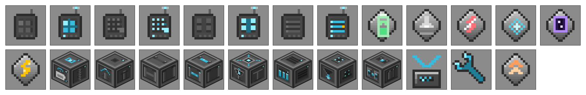

> 官方附属 Quartz Arsenal 也有一台无线合成终端。两者可以共存，也可以只装一个：Quartz Arsenal 只有那一件物品，这个模组还多了距离计费、维度和方块设备。

**简体中文** | [English](#english)

## 当前版本

- Release 页现在提供 **0.4.1（正式版，Latest）**、**0.3.4（稳定线维护版）** 和 **0.3.2（历史记录）**。
- `main` 分支就是 **0.4.1**。想要新设备（样板终端、无线桥、连接器、监控仪显示屏等）用 0.4.1；只想稳在 0.3.x 老功能上用 0.3.4。
- **美术分界**：0.3.3 起（含 0.3.4）与 0.4.1 使用重绘后的新纹理（RS2 风格灰机壳、深灰内嵌面板、青色信号色，方块为多面模型）；**0.3.2 及更早版本保持旧美术，不再回改**。
- **验证范围**：0.4.1 在 NeoForge 侧已实机验证终端绑定、无线样板终端、无线能量接收器、能量监控仪显示屏和无线连接器；其余功能与 Fabric 侧代码一致、构建与 checkstyle 通过，但**未逐项实测**，建议先在测试存档里过一遍并备份世界。

## 内容一览（0.4.1）

### 终端（手持）

| 图标 | 内容 | 作用 |
|---|---|---|
|  | **无线合成终端** | 远程打开 RS 网络、手动合成和自动合成。潜行 + 右键打开插件装配界面。 |
|  | **无线样板终端** | 远程编写自动化样板（合成 / 处理 / 切石 / 锻造四种）。 |
| 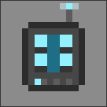 | **无线自动合成仓管理器** | 远程查看和移动全网合成仓的样板。 |
|  | **无线监控终端** | 阈值提醒与自动补货；手持时显示电量 / 距离 / 倍率的 HUD（默认关闭）。 |

### 插件（装在终端的 4 个装配槽里）

| 图标 | 内容 | 作用 |
|---|---|---|
|  | **电池升级插件** | 每张增加 1000 FE 终端容量。 |
|  | **初级能耗插件** | 距离倍率减半，最低仍为 100%。 |
|  | **高级能耗插件** | 同维度距离倍率归 100%，跨维度不变。 |
|  | **距离升级插件** | 同维度不再受距离限制。 |
|  | **维度升级插件** | 通过 Network Transmitter / Receiver 跨维度访问。 |
|  | **远程输电插件** | 优先用绑定网络的电，不足时回落到终端电池。 |

插件随时可以取下，不用重新合成终端。它们是本模组自己的物品，**不等同于 RS 原生升级卡**，两套升级槽不要混用。

### 设备（方块）

| 图标 | 内容 | 作用 |
|---|---|---|
| 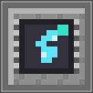 | **终端充电站** | 3 个有线槽 + 无线充电（全场 3 个名额），自动从网络补电。 |
| 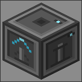 | **无线增幅塔** | 覆盖范围内的终端距离倍率打对折。 |
| 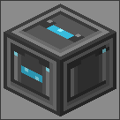 | **无线桥** | 基点 / 据点两种身份，支持跨维度和区块保活。 |
| 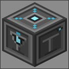 | **无线能量接收器** | 从绑定的网络取电，供给它旁边这张网络（空控制器也能点亮）。 |
|  | **能量监控仪** | 方块上方直接显示电量 / 收支 / 预计耗尽，也可右键看聊天栏。 |
| 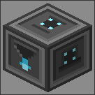 | **智能分拣站** | 按物品或标签把网络物品送到面前容器。 |
| 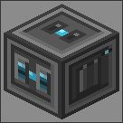 | **网络桥接器** | 在两张独立网络之间转发物品和能量。 |

### 工具

| 图标 | 内容 | 作用 |
|---|---|---|
|  | **无线连接器** | 把接收器、监控仪和两种桥绑到网络。先右键 RS 网络方块记录接入点，再右键目标设备完成绑定；合成 = RS 原版扳手 + 高级处理器 ×2 + 石英富集铁 ×2。 |
| 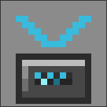 | **无线配置卡** | 复制 RS 方块的设置，或按增幅塔范围批量粘贴。 |
|  | **超频升级卡** | 插进 RS 原版自动合成仓，每张等待间隔折半，最多 4 张。 |

### 配方示例

| 无线合成终端 | 终端充电站 |
|---|---|
| 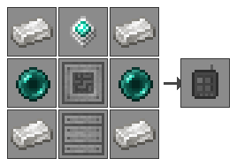 | 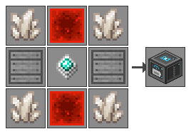 |

## 基本用法

### 绑定网络

本模组终端仍使用 RS 的网卡绑定方式。先让网络方块与终端完成绑定，再打开终端。

对于需要配对的方块设备（接收器、监控仪、无线桥、网络桥接器），统一用**无线连接器**：

1. 拿连接器**右键 RS 网络方块**（控制器、线缆、或任何能给出网络的方块），聊天栏会报「已设置接入点：维度 x, y, z」。
2. 拿连接器**右键目标设备**，完成绑定；两端会各亮起一圈光环，中间撒一条电火花连线。
3. 对着已绑定的设备**再右键一次**即解绑；**潜行右键**清掉手上的接入点记录。

为什么必须用工具：这些设备本身是方块物品，手持它们右键任何方块都会先被原版「放置」逻辑吃掉，方块自己的绑定入口根本轮不到。

无线桥和网络桥接器也可以作为接入点。能量接收器和能量监控仪本身不是接入点，不要拿它们互相绑定。

合成：RS 原版扳手 + 高级处理器 ×2 + 石英富集铁 ×2。

### 距离和耗电

无线终端按“每次动作”收费，不是按在线时间持续收费。

- 同维度 16 格以内为 100% 倍率，超过后按水平距离线性增加。
- 跨维度固定为 1600% 倍率。
- 打开界面默认 5 FE，手动合成 20 FE，自动合成 40 FE。
- 最终费用会受距离、跨维度、能耗插件和增幅塔影响。
- 远程输电插件优先使用网络电，网络不足时才使用终端电池。

示例：在 64 格距离外，未装能耗插件时，距离倍率是 400%，一次 5 FE 的打开操作实际需要 20 FE。

专用服务器的配置文件不会自动把数值推送给客户端。界面上的提示以本地配置显示，真正扣费以服务端配置为准。

## 其他设备的使用注意

### 无线桥

未配对时是基点，配对后变成据点。默认会为两端区块保活，费用包括桥本身和每个保活区块的附加费用。

- 默认桥本身 64 FE/s。
- 每个保活区块额外 512 FE/s。
- 红石可以断开链路。
- 断电或红石挂起不会自动取消已经建立的区块保活，避免远端永远连不回来。
- 重新绑定和解绑会处理旧的链路和目标区块。
- 如果准备卸载模组，先拆掉已配对的据点。

### 无线配置卡

- 普通右键：复制或粘贴一个方块的配置。
- 潜行 + 右键：批量粘贴给附近同类型方块。
- 基础半径 8 格，最大 16 格，垂直范围上下各 4 格。
- 不搬升级卡；需要搬升级卡时请使用 RS 原版配置卡。
- 批量操作前请确认范围内没有不想改动的机器。

### 无线监控终端

最多设置 4 条规则。每条规则可以设置物品、阈值、高于/低于触发方式，以及“提醒”或“补货”动作。

提醒有冷却，补货会复用 RS 的 `ensureTask`，不会重复创建同类任务。自动合成需要网络里有对应样板，且材料足够。

### 超频升级卡


插入 RS 原生自动合成仓的升级槽，每张等待间隔折半，最低为 1 tick，最多 4 张。每张卡的基础能耗为 32 FE/t，由 RS 计入机器耗电。

这张卡通过 mixin 修改 RS 的等待间隔读取逻辑。RS 改字段或方法时，按当前设计会安静失效，不保证继续有效。

### 无线能量接收器

把它当一根「不用铺的电缆」：从一张网络取电，喂给它旁边那张网络。

1. 贴着**要用电的那张网络**放（旁边有控制器或线缆即可）。
2. 用**无线连接器**绑到**有电的那张网络**（比如主基地控制器）。
3. 本地网络的空控制器会被这份电点亮。

- 带宽 = 内部容量的 1/10 每秒，越远越慢（跨维度 1/16）。
- 链路费从**供电方那张网**扣，不是从本地扣。
- 绑定到自己旁边这张网会直接停机，否则就是自己给自己充电。
- 红石信号可停机，缓冲里的电保留。

### 能量监控仪

- 贴着网络方块放就能读那张网，不需要绑定；也可以用连接器绑到远处网络。
- 方块上方悬浮显示电量 / 净收支 / 预计耗尽，48 格内可见、每 0.5 秒刷新。
- 右键在聊天栏看详细数据；比较器输出按电量充盈度 0–15。
- 低于阈值时方块亮红灯。

## 美术与图标

所有物品图标和方块纹理由 `gen_textures.py` 程序化生成（16×16，不依赖外部素材），整体向 RS2 原版靠拢，但保留本模组自己的识别色：

- **机壳**：中性灰钢板 + 1px 深灰描边 + 左上斜面高光，与 RS2 的机器外壳同一配方；旧版的钢蓝配色和四角铆钉已去掉。
- **面板**：六面统一位置的深灰内嵌面板，同一框线、同一内阴影，顶面最亮、侧面居中、底面最暗——用明度表达受光方向，而不是给每面各画一套高光。
- **方块为多面模型**：正面是功能图形，侧面是机壳与结构侧视（桅杆、塔柱、导管与正面同一坐标，结构绕过棱边），顶面是俯视的功能件，底面是暗色基板与线缆槽。
- **信号色**：青色只代表「无线 / 网络」，灰蓝 = 待机，红 = 低电，白 = 通电；每个状态在正面、顶面和侧面都有对应元素，任意角度都能读出来。
- **手持终端**沿用「灰平板 + 天线 + 深色屏幕」，四台终端靠屏幕字形区分（合成矩阵 / 样板点阵 / 监控行 / 管理器阵列）。

README 里的图标由 `gen_readme_images.py` 从同一套纹理生成，方块图标按游戏内的等距投影渲染，所以和物品栏里看到的一致。

## 安装

需要：

- Minecraft 1.21.1
- Refined Storage 2.0.7 或兼容版本
- NeoForge 或 Fabric 加载器

从 Releases 下载对应加载器的 jar，**NeoForge 和 Fabric 只能选一个，不要同时放进 `mods/`**。

升级时先删除旧版本 jar，再放入新版本，避免同名模组重复加载。

## 从源码构建

需要 JDK 21。

```bash
./gradlew -I init-mirror.gradle build
```

构建会执行 checkstyle 和 JUnit 测试。产物在：

- `rswirelesscrafting-neoforge/build/libs/`
- `rswirelesscrafting-fabric/build/libs/`

如果当前网络可以正常访问 NeoForged 官方仓库，也可以直接运行 `./gradlew build`。

## 反馈

- QQ 群：**498700382**
- 加群链接：<https://qm.qq.com/q/ueYTU8T3xK>
- Issues：<https://github.com/KokuuWork/refined-network/issues>

反馈问题时请附上加载器、RS 版本、操作步骤和 `latest.log`。如果涉及存档问题，请先备份，不要只发一张截图。

## 许可

MIT，见 [LICENSE](LICENSE)。

---

## English

An addon for Refined Storage 2.

The vanilla wireless access point has limited range and never crosses dimensions. This mod doesn’t touch it — it goes around it. Terminals work wherever you are, and every action costs FE based on distance; crossing dimensions costs more. A handful of block devices push the network outward.

A terminal you don’t open costs nothing. Blocks draw power while they run. The farther you build, the more power the network needs.


### Current version

- Releases now provide **0.4.1 (stable, Latest)**, **0.3.4 (stable-line maintenance)** and **0.3.2 (historical records)**.
- `main` is **0.4.1**. Use 0.4.1 for the new devices (pattern terminal, wireless bridge, connector, monitor display); use 0.3.4 if you only want the old 0.3.x feature set.

### Terminals

| Icon | Item | What it does |
|---|---|---|
|  | **Wireless Crafting Grid** | Opens an RS network remotely for manual crafting and autocrafting. |
|  | **Wireless Pattern Terminal** | Edit autocrafting patterns remotely (crafting / processing / stonecutter / smithing). |
|  | **Wireless Autocrafter Manager** | View and move patterns across the network. |
|  | **Wireless Monitor Terminal** | Threshold alerts and automatic restocking, plus an optional held-item HUD (off by default). |

### Upgrades (four slots inside a terminal)

| Icon | Item | What it does |
|---|---|---|
|  | **Battery Upgrade** | +1000 FE terminal capacity per card. |
|  | **Energy Upgrade** | Halves the distance multiplier, never below 100%. |
|  | **Advanced Energy Upgrade** | Removes same-dimension distance cost. |
|  | **Range Upgrade** | Unlimited same-dimension range. |
|  | **Interdimensional Upgrade** | Access through Network Transmitter / Receiver. |
|  | **Remote Energy Upgrade** | Uses network energy first, then the terminal battery. |
Cards can be removed at any time. They are **not** RS native upgrade cards — do not mix the two systems.

### Devices (blocks)

| Icon | Item | What it does |
|---|---|---|
|  | **Terminal Charging Station** | Three wired slots plus wireless charging (three global devices), refilled from the network. |
|  | **Wireless Amplifier** | Halves the distance multiplier for terminals in range. |
|  | **Wireless Bridge** | Anchor/endpoint pairing across dimensions, with chunk keeping. |
|  | **Wireless Energy Receiver** | Draws power from the bound network and feeds the network it is placed against. |
|  | **Energy Monitor** | Shows stored / net rate / time-to-empty floating above the block. |
|  | **Smart Sorter** | Routes items or tags into the facing container. |
|  | **Network Bridge** | Transfers items and energy between two independent networks. |

### Tools

| Icon | Item | What it does |
|---|---|---|
|  | **Wireless Connector** | Binds receivers, monitors and both bridges to a network: right-click an RS network block to record an access point, then right-click the device. Crafted from an RS wrench + two advanced processors + two quartz-enriched iron. |
|  | **Wireless Configuration Card** | Copies RS block settings, or batch-pastes within amplifier range. |
|  | **Overclock Upgrade** | Fits an RS autocrafter; halves the waiting interval per card, up to four. |
Everything above ships in **0.4.1 (stable)**. Part of the set was verified in-game on NeoForge; the rest and the Fabric build compile clean and are code-identical, but were not individually tested — use a test world first.

### Distance and energy

Actions have a base cost. Distance and upgrades determine the final cost.
- Same-dimension distance beyond 16 blocks increases the multiplier linearly.
- Cross-dimensional access uses a fixed 1600% multiplier.
- Opening a terminal costs 5 FE, manual crafting 20 FE and starting autocrafting 40 FE by default.
- The remote energy card uses network energy first and falls back to the terminal battery.
The dedicated-server config is not automatically sent to clients. Tooltips show local config values; the server is authoritative for billing.

### Binding block devices

Block devices (energy receiver, energy monitor, wireless bridge, network bridge) are bound with the **Wireless Connector**:
1. Right-click an RS network block with the connector to record an access point — chat reports "Access point set: dimension x, y, z".
2. Right-click the target device to bind it. Both ends light up with a ring and an electric-spark line connects them.
3. Right-click a bound device again to unbind; sneak-right-click to clear the recorded access point.
A tool is required because these devices are **block items**: right-clicking with one in hand always places the block first, so the device's own binding entry can never run.
A wireless bridge or network bridge can also be an access point. An energy receiver or energy monitor is not an access point.

### Wireless energy receiver

Think of it as a cable you do not have to lay: it draws power from one network and feeds the network it sits against.
1. Place it against the network that **needs** power (a controller or cable next to it is enough).
2. Bind it with the **wireless connector** to the network that **has** power.
3. An empty controller on the local network will come alive from that power.
- Throughput = 1/10 of internal capacity per second, slower with distance (1/16 across dimensions).
- The link fee is paid by the **supplying** network.
- Binding it to the network it sits against disables it — otherwise it would charge itself.
- A redstone signal pauses it; buffered energy is kept.

### Energy monitor

- Placed against a network it reads that network without any binding; it can also be bound to a remote network with the connector.
- Stored / net rate / time-to-empty float above the block within 48 blocks, refreshed every 0.5 s.
- Right-click for details in chat; the comparator outputs 0–15 by charge level.
- Turns red below the configured low threshold.

### Art and icons

Every item icon and block texture is generated by `gen_textures.py` (16×16, no external assets). The set leans on RS2's look but keeps this addon's own signal colours:
The icons in this README are produced by `gen_readme_images.py` from the same textures, with block icons rendered in the same isometric projection the game uses, so they match the inventory.

### Building

Use JDK 21:
```bash
./gradlew -I init-mirror.gradle build
```
The build runs checkstyle and unit tests. Install only the jar for your loader, never both.

### Feedback

- QQ group: **498700382** — <https://qm.qq.com/q/ueYTU8T3xK>
- Issues: <https://github.com/KokuuWork/refined-network/issues>
Include your loader, RS version, steps to reproduce and `latest.log` when reporting a problem.
MIT licensed. See [LICENSE](LICENSE).
